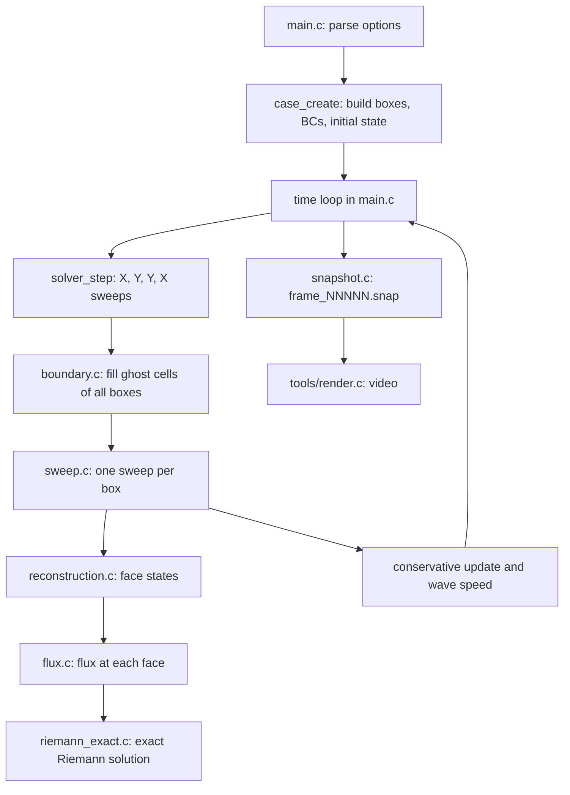

# Architecture

This page explains what each part of the code does, how data flows through a run, and where to
make common changes.

## Code map

```
src/
  main.c                    command line, time loop, frame output
  mesh/
    box.h, box.c            the Box: cell arrays, ghost cells, INDEX(), variable conversion
    boundary.c              boundary conditions: fill ghost cells before each sweep
  numerics/
    riemann_exact.[ch]      exact Riemann solver for the 1D Euler equations (Toro, chapter 4)
    flux.[ch]               Godunov flux through one face, from the Riemann solution
    reconstruction.[ch]     MUSCL-Hancock face states and slope limiters
    sweep.[ch]              x and y sweeps: face states -> fluxes -> conservative update
  solver/
    stepper.[ch]            one X-Y-Y-X time step over all boxes
  cases/
    cases.[ch]              case table and helpers (case_add_box, case_connect, ...)
    jet.c, sod.c, step.c, injection.c   the built-in problems
  io/
    snapshot.[ch]           binary frames (write and read) and the CSV writer
tools/
  render.c                  frames -> mp4 / ppm
  snapshot.py               frames -> numpy
tests/                      regression, physics, I/O and docs checks
bench/                      performance benchmarks (not part of the normal build)
```

The layers only depend downward: `numerics` knows nothing about cases or output, `mesh` knows
nothing about the scheme, and the Riemann solver is a plain 1D function.

## Data flow of a run



1. **Setup.** `main` parses the options and calls `case_create`, which runs the case's setup
   function. The case fills `struct Case` with the boxes, their boundary conditions and initial
   state, and the default end time.
2. **Time step.** Each step, `main` computes Δt from the CFL condition and calls `solver_step`.
3. **Splitting.** `solver_step` (stepper.c) performs four passes: x, y, y, x. Each pass first fills
   the ghost cells of *all* boxes (so connected boxes exchange data from the same time level), then
   sweeps every box. Alternating the order cancels the leading splitting error.
4. **Sweep.** For each line of cells along the sweep direction, `sweep.c` gets the face states
   (cell averages for first order, MUSCL-Hancock otherwise), computes the flux at every face, and
   updates each cell with \(u_i \mathrel{+}= \frac{\Delta t}{h}(F_{i-1/2} - F_{i+1/2})\). It then converts
   the updated cells to primitive variables and records the largest wave speed, which sets the next
   time step.
5. **Output.** When the time reaches the next frame time, `main` writes a frame.

## The Box

A box is an nx × ny block of cells surrounded by `BOX_NG = 2` layers of ghost cells (two layers are
needed by the MUSCL stencil). Each cell has 8 values stored in 8 separate arrays (structure of
arrays): the primitive variables `w_1..w_4` = (ρ, u, v, p) and the conserved variables
`u_1..u_4` = (ρ, ρu, ρv, E).

- **Indexing.** `INDEX(i, j, nx)` gives the array position of cell (i, j). Interior cells are
  i = 1..nx, j = 1..ny; ghost cells are i = -1, 0 and nx+1, nx+2 (likewise in j). Rows are contiguous.
- **Memory.** The 8 arrays live in one allocation, each padded to a page and offset slightly, so the
  same cell in different arrays doesn't compete for the same cache lines.
- **Ghost cells** hold primitive variables only. Before a sweep they are filled by `boundary.c`
  according to each edge's boundary type: copied from the neighbour box (connected), mirrored with
  the normal velocity flipped (wall), copied outward (open), or set to a fixed state (inflow).
- **Primitive vs conserved.** The update is done on the conserved variables (that's what makes the
  scheme conservative); reconstruction and the Riemann solver work in primitive variables.

## Where to change what

| To add or change | Edit | Also update |
|---|---|---|
| A case | new `src/cases/<name>.c`; declare in `cases.h`; add to `CASES[]` in `cases.c` | `docs/cases.md` (checked by `make test`) |
| A solver option | `struct Options`, `set_defaults`, `parse_args` and `usage` in `main.c` | `docs/options.md` (checked by `make test`) |
| A renderer option | `struct Options`, `parse_args` and `usage` in `tools/render.c` | `docs/options.md` (checked by `make test`) |
| A slope limiter | `enum Limiter` in `reconstruction.h`, `muscl_limit` in `reconstruction.c`, `--limiter` in `main.c` | `docs/options.md`; add it to the scheme list in `tests/test_physics.c` |
| A boundary type | `enum BoundaryType` in `box.h`, a setter and a branch in `apply_edge` in `boundary.c`, the label in `save_box_connections` | `docs/new-case.md` |
| A stored field | `enum SnapField` and `FIELD_NAMES` in `snapshot.[ch]`, the array choice in `snapshot_write`, `FIELD_NAMES` in `tools/snapshot.py` | `docs/options.md`, `docs/output-and-rendering.md` |
| Gamma | `GAMMA` in `main.c` (the tests define their own) | `docs/index.md` |
| Riemann solver tolerance | `star_p_tol` in `flux.c` | regenerate the goldens (see [Testing](testing.md)) |
| A different Riemann solver | replace the call in `calculate_flux_1D` (`flux.c`) | regenerate the goldens |

Any change to the numerics changes the results, so the regression test will fail until the goldens
are regenerated; see [Testing](testing.md).
